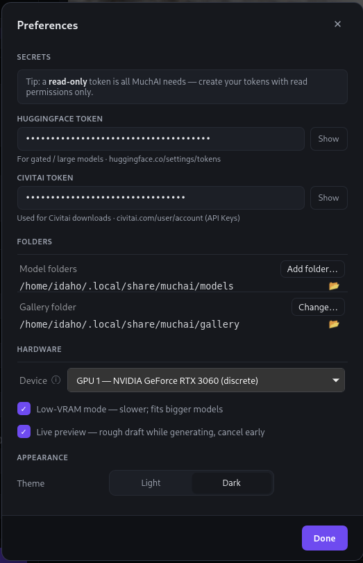
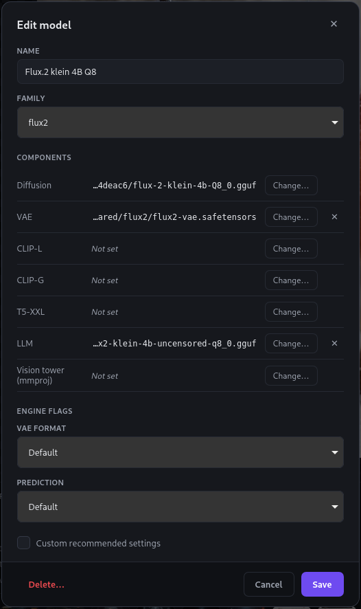

# Getting more out of MuchAI

This guide assumes you have made a few pictures and want to know why the dials
do what they do. If you have not, read [Making your first
picture](guide-basics.md) first.

## How the pieces fit

MuchAI is a desktop front end for
[stable-diffusion.cpp](https://github.com/leejet/stable-diffusion.cpp), a C++
engine that runs image models on Vulkan or on the CPU. MuchAI manages models,
builds the command line, and shows you the result; the engine does the maths.
You can update or roll back that engine independently of the app.

A "model" is often not one file. Most modern families are assembled from:

- a **diffusion model** — the large file that does the denoising,
- one or two **text encoders** — they turn your words into something the
  diffusion model understands,
- a **VAE** — it converts between the compressed space the model works in and
  actual pixels.

This is why the Add-a-model dialog has several rows for some entries, why the
model editor exists, and why a model can be broken in a way that produces noise
rather than an error: mismatched components load happily and generate garbage.

## Choosing a family

MuchAI's catalog covers seven families. They differ more than their sizes
suggest.

**SD 1.5** — the oldest, smallest, fastest. Native resolution 512×512. Enormous
LoRA and fine-tune ecosystem. Weak prompt following by modern standards, and it
cannot render text.

**SDXL** — 1024×1024 native, much stronger composition than SD 1.5, still small
enough to run on modest hardware. The safe default if you want a large
community and reliable results.

**Z-Image** — a recent, small, guidance-distilled model. Eight steps at CFG 1.
Very fast for its quality; good general-purpose choice on limited VRAM.

**FLUX.2** — four steps at CFG 1, strong text rendering, and the *klein*
variants are small enough to be practical.

**Flux.3 klein** — the newest FLUX. Sixteen steps at CFG 1. It both generates
and edits: give it a reference image and it changes that image instead.

**Qwen-Image 2.1** — very strong at text, including non-Latin scripts, and at
following long, structured prompts. Like Flux.3 it both generates and edits.
Uses real guidance, at CFG 6.

**Older families.** FLUX.1, Qwen-Image, Qwen-Image-Edit and FLUX.1 Kontext are
no longer in the catalog, but models you already have keep working, and you
can still add them by URL. Note that neither *Qwen-Image 2512* nor the
*Layered* variants are editors, despite the similar names.

## Quantization

Almost everything in the catalog is a GGUF file at some quantization level.
Quantization stores each weight at reduced precision, shrinking the file and the
memory it needs, at some cost in fidelity.

The tiers run roughly `Q2_K` < `Q3_K_S` < `Q4_K_S` < `Q4_K_M` < `Q5_K` < `Q6_K`
< `Q8_0`. Higher is closer to the original weights and larger on disk.

- **`Q8_0`** is visually indistinguishable from the unquantized model in almost
  every case.
- **`Q4_K_S` / `Q4_K_M`** are the usual sweet spot: about half the size of 8-bit
  for a quality difference you have to look for.
- **Below `Q3`** degradation becomes obvious — mushy detail, worse prompt
  adherence, anatomy errors.

**fp8 checkpoints are a trap worth stating plainly.** An fp8 file does *not* stay
fp8 in memory. The engine widens it on load, so it occupies roughly double its
file size in RAM: a 7.9 GB fp8 text encoder needs about 15.8 GB. If you size your
hardware against the file listing you will run out of memory with no obvious
explanation. Prefer a GGUF of the same component.

Separately, ComfyUI's "scaled fp8" checkpoints are a different format that this
engine does not understand. They load without complaint and produce noise.

## Fitting a model in memory

The badge in the catalog compares an estimate against your hardware. The
estimate is deliberately rough: **weights × 1.15, plus 1.5 GB** of working space
for activations. A 6 GB model therefore wants about 8.4 GB to run comfortably.

The badge is advice, not a gate. Where the weights actually go is decided by
the engine at load time: it fills the GPU you picked first, then system RAM,
then disk. A model larger than your card still runs at full precision, only
slower, because the part that spills is copied to the GPU as it is needed.
There is nothing to switch on for this.

**Shared-memory budget** applies only to unified-memory devices: integrated
GPUs, AMD APUs, systems where "VRAM" is really system RAM. On such a device
there is no fixed VRAM figure to read, so MuchAI assumes one for the catalog
badge: `min(70% of total RAM, total RAM − 4 GB)`, never below 1 GB. Setting the
field overrides that calculation; out-of-range values are clamped, and the hint
below the field always names the figure actually in force — trust the hint, not
what you typed. On a discrete card this setting is ignored, and says so.

## Parameters that matter

**Steps** — how many denoising passes. More steps refine detail up to the point
where the model converges, then do nothing but cost time. The right number is a
property of the model, not a preference.

**CFG scale** — how hard the model is pushed towards your prompt. Higher is more
literal and, past a point, produces burnt contrast and rigid compositions.

**Sampler** — the algorithm stepping through the denoising schedule. Euler and
Euler a are safe defaults; the rest trade speed against character. Euler a is
*ancestral*, meaning it injects noise at each step, so it does not fully converge
— two runs at different step counts will differ more than with plain Euler.

**Width / height** — generate at the model's native resolution. SD 1.5 wants
512×512; everything newer wants 1024×1024. Going far above native produces
duplicated limbs and repeated subjects, not more detail.

**Seed** — the random starting point. `-1` means a fresh one each run. Fix it to
a number and everything else held constant reproduces the same image exactly,
which is how you isolate the effect of changing one other setting.

**Batch count** — how many images per run. Each one costs the full generation
time.

**The turbo families invert the usual advice.** FLUX.1, FLUX.2, Flux.3 and Z-Image are
guidance-distilled: guidance is baked into the weights, so they run at **CFG 1**
and **ignore the negative prompt entirely**. Turning CFG up on one of them does
not make it follow the prompt harder, it degrades the image. Only SD 1.5 and SDXL
use a conventional CFG around 7; Qwen-Image uses real guidance but wants a low
2.5, and Qwen-Image 2.1 wants 6.

Rather than memorise this, use **Use recommended settings**, which fills in the
values known to work for the selected model:

| Family | Steps | CFG | Sampler | Size |
|---|---|---|---|---|
| SD 1.5 | 20 | 7.0 | Euler a | 512² |
| SDXL | 28 | 7.0 | Euler a | 1024² |
| FLUX.1 dev / krea | 20 | 1.0 | Euler | 1024² |
| FLUX.1 schnell | 4 | 1.0 | Euler | 1024² |
| FLUX.2 | 4 | 1.0 | Euler | 1024² |
| Flux.3 klein | 16 | 1.0 | Euler | 1024² |
| Z-Image | 8 | 1.0 | Euler | 1024² |
| Qwen-Image | 20 | 2.5 | Euler | 1024² |
| Qwen-Image-Edit | 20 | 2.5 | Euler | from your image |
| Qwen-Image 2.1 | 20 | 6.0 | Euler | 1024², or from your image |

The button leaves width and height alone when a reference image is loaded — an
edit takes its size from the input.

## LoRAs

A LoRA is a small file, typically tens to hundreds of megabytes, that shifts a
base model towards a style, character, or subject. Several can be active at once,
each with its own **strength** — 1.0 is the trained weight; 0.5–0.8 blends more
gently; stacking several at full strength usually muddies all of them.

Add one from a file, or by pasting a Civitai link, which also brings across the
LoRA's name and its trigger words. Trigger words are clickable and append
themselves to your prompt. A LoRA trained with a trigger will do very little
without it.

**Compatibility is your call.** A LoRA is trained against one base family and
generally only works with that family. MuchAI shows the family as a badge and
does not enforce it, deliberately: the metadata on downloaded LoRAs is often
missing or wrong, and only you know what a file was actually trained on. Treat
the badge as a hint. A genuine mismatch does not usually fail loudly — it
degrades the image, which is a harder symptom to read, so suspect the LoRA when
output quality drops for no other reason.

## Instruction editing in depth

Editing needs a model that can read a reference image: Flux.3 klein, Qwen-Image
2.1, or the older Qwen-Image-Edit and FLUX.1 Kontext. Select one and an **Image
to edit** panel appears. Attach an image and the prompt box becomes
**Instruction**; leave it empty and Flux.3 and Qwen-Image 2.1 generate from text
as usual.

The instruction must describe a *change*. "Make the sky stormy" edits the sky.
"A house under a stormy sky" is a complete image description, so you get a new
image. This single distinction accounts for most disappointing first edits.

**Editing costs more than generating.** A reference image adds to the work of
every step. On a 12 GB RTX 3060, a 512×512 Flux.3 klein edit took about 24
seconds of sampling against 12 for the same image from text. The older
Qwen-Image-Edit is far slower, around 41 seconds a step on that card.

**Use recommended settings** applies each family's values. Output size is
matched to your input image automatically. An edited result can be
fed straight back in as the next input, which is usually better than trying to
express two changes in one instruction.

## Bringing your own models

The Add-a-model dialog has three tabs beyond the catalog's curated list:

- **URL** — paste a direct link to a `.safetensors` or `.gguf` file. Not a page
  URL: the link must resolve to the file itself.
- **Local file** — point at something already on disk. Nothing is copied.

For multi-file families, the model editor gives you a row per component — the
diffusion model, each text encoder, the VAE — plus per-model default parameters
that get applied whenever you select it.

Hugging Face and Civitai tokens go in Preferences → Secrets; read-only scope is
all MuchAI asks for. Note that gated Hugging Face repositories return 401 even
with a valid token unless you have accepted that model's licence on the website
— for gated weights, an ungated community mirror is usually the faster route.

## Devices

Preferences → Hardware → Device selects the backend. MuchAI lists every Vulkan
device it finds, plus CPU.

CPU generation works and is roughly an order of magnitude slower than a modest
GPU. It is a fallback, not a mode to work in.

**Do not generate on an Intel integrated GPU.** On the i915 driver, the render
fence is force-expired after 10 seconds. A diffusion step takes far longer than
that, so fences expire continuously; because the same GPU is also driving your
desktop, the compositor starves and the session locks up hard enough to need a
power cycle. The timeout is compiled into the kernel rather than exposed as a
module parameter, so there is no setting — in MuchAI or anywhere else — that
avoids it. If you have a discrete card, select it explicitly rather than relying
on the default. If Intel integrated graphics is your only GPU, use CPU. This is a
driver limitation, not a MuchAI bug.

## Engine updates

Preferences → Engine tracks stable-diffusion.cpp releases. MuchAI can check once
a day in the background, shows what changed in a build before you take it, and
installs on request.

The build MuchAI shipped with is never discarded — **Switch to → Built-in** puts
it back. That is your recovery path, and you will occasionally need it: engine
updates are upstream releases, and a new build can change or break support for a
specific model. If a model that worked yesterday produces noise or fails to load
today, revert the engine before you suspect the model.

## Where things live, and what is in your files

Model and gallery folders are set in Preferences → Folders. Models can live
across several folders; MuchAI scans all of them. Disk pressure is handled from
the Add-a-model dialog, which offers to reclaim space by deleting installed
models when a download will not fit.

Your settings are recorded twice, in two different places, and the difference
matters.

The engine embeds a `parameters` text chunk in the image itself — the same
convention other generators use, so a PNG dropped into another tool will
generally give up its prompt and settings. MuchAI *also* writes a **`.json`
sidecar with the same name**, holding the full request: prompt, seed, sampler,
model, LoRAs and their strengths.

The **Load** button reads the sidecar, not the embedded chunk. So a `.png`
copied somewhere without its `.json` keeps a record other tools can read, but
MuchAI itself can no longer restore those settings from it. Deleting from within
MuchAI moves both files to the system Trash together, which is why deleting
there is safer than deleting in a file manager.
